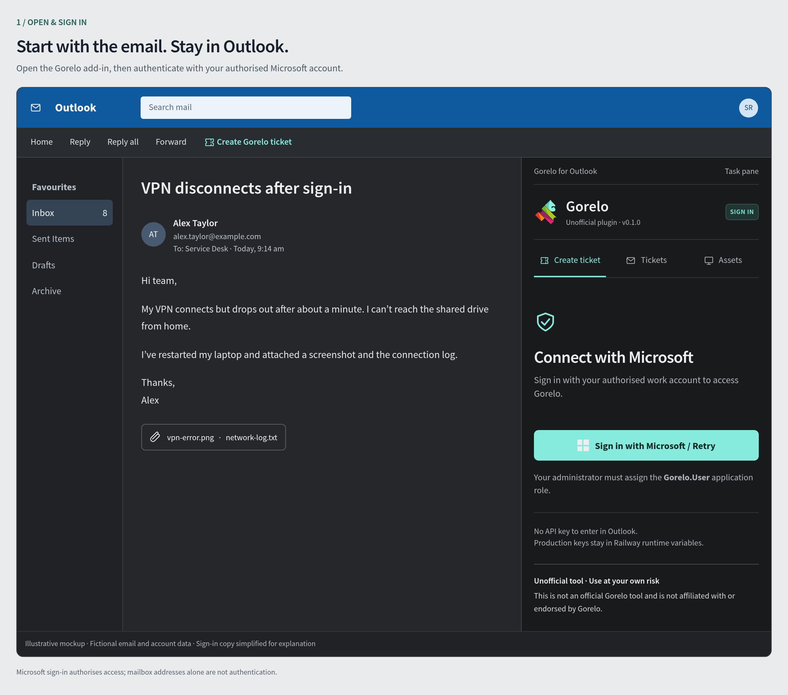
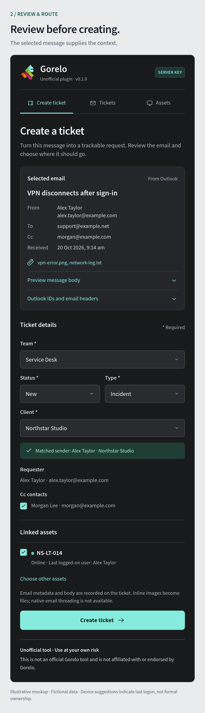
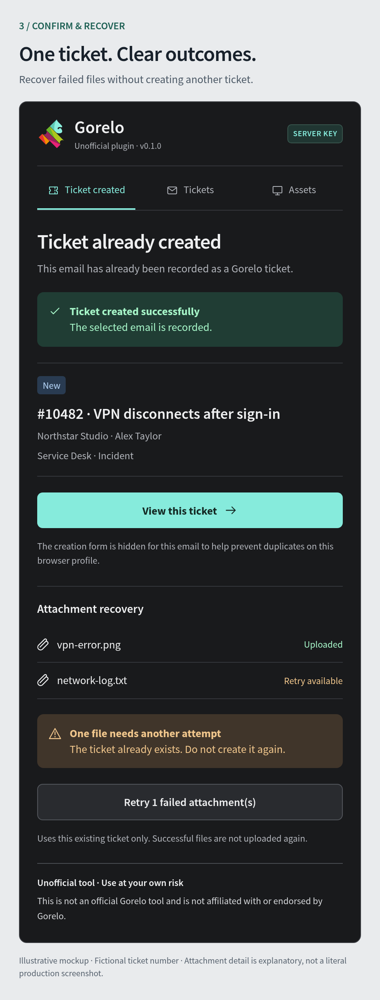
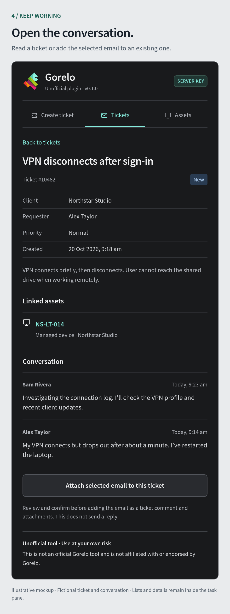
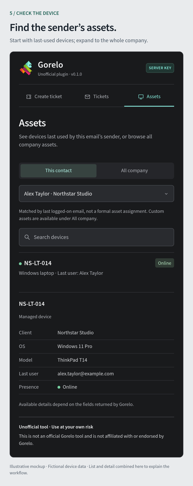

# Gorelo for Outlook

An unofficial Outlook add-in for creating Gorelo tickets from selected emails, searching tickets and conversations, and viewing managed devices and custom assets without leaving Outlook. It uses the [published Gorelo API](https://api.usw.gorelo.io/swagger/index.html) and Office.js to read the selected email. It is not an official or endorsed Gorelo product.

> Disclaimer: This is not an official Gorelo tool and is not affiliated with or endorsed by Gorelo. Use at your own risk. No warranty is provided. Review permissions and data handling, and test with non-sensitive email before using it in production.

## See the workflow

Open a message in Outlook, review its details, and create a Gorelo ticket without
switching apps. You can also browse ticket conversations, attach the selected
email to an existing ticket, and look up devices and custom assets.

**These are illustrative workflow mockups, not live production screenshots.**
All people, companies, emails, tickets and devices shown are fictional. Some
screens combine or simplify states to explain the workflow; actual appearance
depends on your Outlook client, permissions and Gorelo configuration.

### 1. Open the add-in and sign in

Select an email and open **Create Gorelo ticket**. Sign in with your assigned
Microsoft account; production API keys stay on the server in Railway.



| 2. Review and route | 3. Confirm and recover |
| --- | --- |
| Review the email, team, status, type, client, contacts and linked assets before creating the ticket. | Open the created ticket and retry failed attachments against that same ticket. Duplicate protection is local to the browser profile. |
|  |  |

| 4. Read the conversation | 5. Find relevant assets |
| --- | --- |
| Read ticket details and conversations, or review and confirm adding the selected email as a comment and attachments—not an email reply. | View last-used devices or browse company assets. Last-logon suggestions do not establish device ownership. |
|  |  |

## Deploy your own copy

We deployed this add-in on **Railway**, with Microsoft Entra single sign-on through Outlook nested app authentication (NAA).

If you choose Railway, sign up using [our Railway referral link](https://railway.com?referralCode=URuhGI) to get **$20 in Railway credits upon signup**. This is a referral link; hosting costs are separate from this project.

Follow [Deploy on Railway](deploy-railway.md) for the complete setup: your own repository, Railway service, Microsoft app registration, runtime variables, persistent storage, manifest, and Outlook installation. You need your own Gorelo API key and Microsoft tenant/app registration. Do not reuse the author's deployment, hostname, or registration IDs.

Production stores Gorelo and optional OpenCode API keys in **Railway runtime variables**, never in the frontend, manifest, Docker image, or GitHub repository. All business API routes require a signed Microsoft access token and the assigned `Gorelo.User` role. Public static assets, `/healthz`, and `/api/auth-config` do not expose API keys. The app opens only inside supported Outlook clients; a normal browser displays an instruction to open Outlook.

## How GitHub and Railway stay in sync

Our production service was configured to track `main` through Railway's GitHub integration and wait for CI. GitHub CI runs tests, a production build, dependency checks, and a full-history secret scan. Confirm **Wait for CI** on your own service: this source does not configure that Railway setting for you.

The usual workflow is: edit a **Git checkout**, create a branch and pull request, let CI pass, then merge to `main`. Railway builds and deploys that commit. A copied folder without `.git` does not sync automatically. Check `git remote -v`, `git status`, and Railway's deployed commit before assuming your changes are live. This repository does not itself configure Railway's GitHub integration or branch protections.

No GitHub deployment token or API key is needed for that integration. Runtime variables and persistent attachment data stay in Railway and are not synchronized to Git. Treat a merge to the deployment branch as a production release.

Maintain **one canonical codebase**. Update the existing Railway service from
that repository; do not maintain a separate private and public implementation.
Use [the existing-deployment upgrade steps](deploy-railway.md#upgrade-an-existing-deployment-one-codebase)
for image updates. Generated clean-source candidates are release snapshots,
not separately maintained projects. Existing Outlook installations keep their
current manifest ID and hostname.

## Keep secrets and customer data out

Read [SECURITY.md](SECURITY.md) before your first commit or publishing a fork. `.gitignore`, `.dockerignore`, and `.railwayignore` exclude local credentials and private runtime data, but ignore files do not remove previously tracked files or history. CI scans Git history with Gitleaks; no scanner guarantees detection of every secret, especially arbitrary Gorelo keys.

Never put secrets in `VITE_*` variables: Vite bundles them into downloadable JavaScript. Do not upload `.env` files, private certificates, email exports, attachment retry data, diagnostic screenshots, or source archives. If a key was ever committed, revoke/rotate it first; deleting the current file is not enough.

## Development and checks

Use Node.js 22 or later:

```bash
npm ci
npm test
npm run test:public-source
npm run test:licenses
npm run build
npm audit --audit-level=high
```

For localhost Outlook development, install [mkcert](https://github.com/FiloSottile/mkcert#installation), generate a trusted certificate into `certs/localhost.pem` and `certs/localhost-key.pem`, then run `npm run dev`. Sideload `manifest.xml` on the **same computer as Outlook**. Never share the certificate's private key. Local mode stores a user-entered Gorelo key in browser/WebView storage; use only a trusted device. Production must use server-managed keys and Entra authentication instead.

`npm run test:outlook-host` checks standalone-browser rejection and Outlook startup after serving a build; see the test's `TEST_ORIGIN` and `BROWSER_EXECUTABLE_PATH` settings. Tests use synthetic data and do not prove your own Outlook, tenant, or live Gorelo integration works. Do read-only acceptance checks before any deliberate test writes.

## Behaviour and limitations

- Create tickets from selected mail, with sender/recipient metadata and sanitized message body. Link managed or custom assets. A missing requester/contact may be created as part of the confirmed operation; review recipients and assignments first.
- Attach a selected email to an existing ticket as a comment and attachments. This does not send a reply or create native Gorelo email threading.
- Attachments are limited to 10 MB each, 25 MB total, and 20 files. Unsupported formats stop creation. Partial failures report the existing ticket and support attachment recovery; unknown-outcome ticket writes are never automatically replayed.
- The local ticket-created record helps prevent duplicate creation on that browser profile. It is not a cross-device idempotency guarantee.
- Device suggestions use last-logon information, not formal ownership. Search and asset detail depend on fields exposed by Gorelo.
- Optional AI suggestions send the subject and up to 2,500 characters of plain-text body to OpenCode Zen. Leave `OPENCODE_API_KEY` unset unless your privacy requirements permit this processing. Suggestions never replace review before creation.
- Failed attachment bytes expire seven days after the record's last update, checked on access and hourly while running; retries can extend this period. Receipts remain for duplicate protection, and backups have their own retention. Protect the volume and backups as customer data.
- Mutation audit records contain verified Microsoft tenant/user IDs, operation, ticket ID, correlation ID, and outcome—not email bodies, attachment contents, tokens, or API keys. Production requires persistent retry and audit directories. Configure log monitoring and retention; the app does not rotate or centrally export logs for you. See [deployment storage guidance](deploy-railway.md#updates-storage-and-rollback).

## License and third-party assets

The project's original code and documentation are licensed under the [MIT License](LICENSE). You may use, modify and redistribute that code, including commercially, while retaining the copyright and license notice. It is provided as-is, without warranty.

The UI uses Gorelo's mark and self-hosted, unmodified **Adobe Source Sans 3** fonts from a pinned official release, plus [Font Awesome Free solid icons](https://fontawesome.com/license/free) (© Fonticons, Inc., CC BY 4.0), not Gorelo's licensed Pro font. Third-party assets and dependencies remain subject to their own terms. MIT does not grant rights to Gorelo's name, trademarks or branding, or imply endorsement; see [THIRD_PARTY_NOTICES.md](THIRD_PARTY_NOTICES.md).

The app's **Credits and licenses** link opens a public [credits page](public/credits.html)
with Adobe/Paul D. Hunt, Fonticons, Microsoft and Gorelo acknowledgements. Complete
[font notices, verified source and OFL](public/licenses/source-sans-3-OFL.md) and
[browser/direct-runtime dependency licenses](public/licenses/npm-dependencies.md)
ship in the source export and built app. Dependency updates must pass
`npm run licenses:check`; regenerate reviewed notices with `npm run licenses:update`.

For the source-only publishing process and future release checks, see [PUBLIC_RELEASE.md](PUBLIC_RELEASE.md). Keep private production history private; the exporter prepares a separate review candidate and does not change repository visibility. [Third-party notices](THIRD_PARTY_NOTICES.md) record provenance, attribution and review limits. [Docker deployment](deploy.md) is an alternative for experienced administrators; Railway is the recommended documented path.
